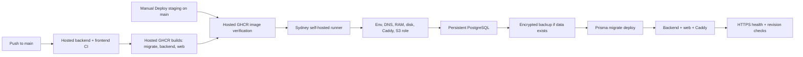

# GitHub Actions to existing Sydney EC2: release procedure

This is the current CI/CD plan for the **existing** `ap-southeast-2` Amazon Linux 2023 `t3.small` host and its `kaamdhaam-ec2-runner`. It replaces the older Mumbai/t3.medium *provisioning proposal* for deployment purposes. No new EC2, IAM, bucket, DNS, or Supabase resource is created by this repository change. The host is not deployed yet.

## Pipeline and safety boundary



`.github/workflows/ci.yml` keeps all existing backend/frontend checks and audits on GitHub-hosted Ubuntu. After both pass on `main`, a hosted job publishes three GHCR images, each tagged with the full Git commit SHA: `ghcr.io/samyak191/kaamdhaam-migrate:<sha>`, `...-backend:<sha>`, and `...-web:<sha>`. The web build fixes `VITE_APP_MODE=live` and `VITE_API_BASE_URL=/v1`. The dedicated KaamDhaam Supabase URL and its *public* publishable key are build inputs; Vite embeds them in browser code. No service-role key or database secret enters an image. OCI revision/source labels identify each image.

Only `.github/workflows/deploy.yml` has a self-hosted job. It is triggered by `workflow_dispatch` with `deploy_to_ec2=true` on `main`. A GitHub-hosted job first verifies that the successful push already published all three commit images; manual deployment does not rebuild or replace tags. The deploy job selects labels `self-hosted`, `Linux`, `X64`, `kaamdhaam-deploy` and checks the exact runner name. The committed CI workflow's pull-request jobs use hosted runners only. A deployment concurrency group never cancels an active release. The deploy job needs `packages:read` and uses a temporary Docker credential directory; the hosted publish job alone has `packages:write`. The built-in `GITHUB_TOKEN` is sufficient if GHCR packages grant this repository access. No long-lived GitHub or AWS key is required. An optional `staging` environment can add reviewer protection if the repository plan supports it; manual dispatch is the first-release gate even without that feature. Later automatic deployment can add a trusted-main completion trigger and SHA selection to this separate deploy workflow without changing the release scripts.

**Runner isolation setting is required:** if this repository accepts untrusted pull requests, YAML alone cannot stop a PR from proposing a modified CI workflow that targets a repository-level self-hosted runner. Before relying on this runner, restrict its runner group to the `deploy.yml` workflow if the account supports that setting, or otherwise prevent untrusted PR workflows from accessing this runner (for example, use a private repository with controlled collaborators). Verify the actual repository/runner policy in GitHub settings before first deployment. [GitHub's runner security guidance](https://docs.github.com/en/actions/reference/security/secure-use) warns that persistent self-hosted runners are unsafe for untrusted public PR code.

## Configuration before the first manual deployment

### Fast track for the existing Sydney host

Use `deploy/scripts/bootstrap-existing-ec2.sh` in an approved Session Manager terminal after this commit is pushed. It is for the already provisioned Amazon Linux 2023 server; `bootstrap-al2023.sh` is the earlier OS/Docker installation script and is unnecessary here. From a trusted checkout of the intended release, run:

```bash
systemctl list-units --all 'actions.runner*' --no-pager
systemctl show -p User --value <actual-runner-unit-name>
sudo bash deploy/scripts/bootstrap-existing-ec2.sh <actual-runner-service-user>
```

Use the unit name and service account reported on the host. If `User` is empty, inspect the unit and pass its actual service account explicitly; do not guess. The script checks Docker access as that user, Python, AWS CLI, disk (at least 6 GiB free), total/available RAM (at least 1.8 GiB/512 MiB), and the existing database volume. It prompts privately for the dedicated Supabase URL and publishable key, generates a random PostgreSQL password **only when both server env files and the project database volume are absent**, and creates root-owned, runner-group-readable env files. Existing files and volumes are left in place. It validates their contents and merged Compose configuration without pulling images or starting containers. The password is not printed or stored in Git. Back up these env files through an approved encrypted process before treating host loss as recoverable. If the volume already exists but env files do not, recover its original credentials rather than generating new ones.

The script's Git checkout must be the same reviewed commit that will be dispatched, because `ghcr.compose.yaml` uses its full SHA. It checks that the runner account can inspect all three published GHCR manifests. `verify_images` repeats that check on a hosted runner, and the deploy job uses its short-lived `GITHUB_TOKEN` for an authenticated pull. No personal access token belongs on EC2. The published app images are prebuilt; the only on-host build on later releases is the small `age` backup helper when an existing database requires backup. A 2 GiB host passes only a minimum headroom check, not a capacity guarantee; measure memory and restart counts after the first release.

Before the first dispatch, set `AGE_RECIPIENT` to a public age recipient and `BACKUP_S3_URI` to the real approved `s3://<bucket>/backups` prefix as GitHub Actions variables. Keep the age private identity off EC2. The instance profile must allow `s3:ListBucket` for `backups/*` and `s3:PutObject` plus `s3:GetObject` for `backups/*`; the upload uses SSE-S3 (`AES256`). A successful `ListBucket` preflight does **not** prove upload works. After approval, test an encrypted backup object upload, checksum retrieval, and restore to an isolated database before treating off-host backup as verified. Do not name a bucket until its actual destination and access are confirmed.

While `.IN` KYC or DNS is pending, bootstrap and Compose config checks may run over Session Manager; container startup and the manual deploy stay blocked. `preflight-ec2.sh` requires `staging.kaam-dhaam.in` to resolve to `3.104.58.162` before Compose starts, and `smoke.sh` requires trusted HTTPS. A local or private-network HTTP check can diagnose a running service later, but cannot satisfy public staging acceptance. Confirm Supabase Site URL and redirect allowlist use the final HTTPS host.

The checked-in workflows send all pull-request jobs to GitHub-hosted runners, and only the manual `main` deployment uses the `kaamdhaam-deploy` runner. Verify its runner group/workflow access in GitHub settings: untrusted contributors must not be able to run altered PR workflows on it. Docker group access on this runner is effectively host administrator access.

Create repository **Actions variables** (public configuration, never passwords):

| Variable | Required value |
| --- | --- |
| `VITE_SUPABASE_URL` | `https://tvynmgcbyathsgguezye.supabase.co` (dedicated KaamDhaam project only) |
| `VITE_SUPABASE_PUBLISHABLE_KEY` | This same project's publishable key; it is intentionally public in the web bundle |
| `COMPOSE_PROJECT_NAME` | The chosen existing Docker Compose project name, for example `kaamdham-beta`; **verify before first run** because this determines the PostgreSQL volume name |
| `STAGING_HOST` | Approved DNS hostname pointing to this EC2; no URL scheme or path |
| `EXPECTED_PUBLIC_IPV4` | This EC2's approved public IPv4; preflight compares DNS |
| `AGE_RECIPIENT` | Public age recipient whose private identity is held off-host |
| `BACKUP_S3_URI` | Approved `s3://<bucket>/backups` prefix accessible via the EC2 instance role |

No custom GitHub Actions secret is required. Do not add AWS access keys, PostgreSQL passwords, private age identity, Supabase service-role keys, or JWT tokens to repository variables or workflow files. The runner must use its EC2 IAM instance role for the backup bucket. GHCR packages must allow repository Actions read access; verify package access after first publish. Protect `main` and limit who can run the manual deployment workflow.

On the EC2 host, prepare the following **before clicking Run workflow**:

1. `/etc/kaamdhaam/compose.env`, readable by the runner and mode `0600` or `0640`, based on `deploy/.env.example`. Fill `POSTGRES_DB`, `POSTGRES_USER`, a unique `POSTGRES_PASSWORD`, `STAGING_HOST`, and the exact dedicated `VITE_SUPABASE_URL` / `VITE_SUPABASE_PUBLISHABLE_KEY`. Add `BACKEND_ENV_FILE=/etc/kaamdhaam/backend.env`. If the host already has a KaamDhaam database, retain its **actual existing** database name, user and password; never change them to match an example.
2. `/etc/kaamdhaam/backend.env`, also mode `0600` or `0640`, based on `deploy/backend.env.example`. Set `DATABASE_URL=postgresql://<user>:<URL-encoded-password>@db:5432/<db>?schema=public`, `CORS_ORIGINS=https://<staging-host>`, `NODE_ENV=production`, `TRUST_PROXY_HOPS=1`, and the matching Supabase issuer/JWKS. Do not use a service-role key or a symmetric JWT secret; the API verifies the dedicated project's JWKS.
3. `/opt/kaamdhaam/state`, owned and writable by the runner service account. The release records `current` and `previous` verified commit SHAs here only after health checks pass. Keep this directory across checkouts.
4. DNS A record points to the approved EC2 public IP; 80/443 can reach Caddy, while 22, 4000, 5432 and 8080 are not publicly open. Verify Caddy configuration, TLS hostname ownership, Supabase Site URL and exact redirect allowlist for `/login`, `/onboarding`, `/reset-password`, and the instance-role-only S3 backup prefix. The first trusted certificate is issued when Caddy starts; the post-start smoke check must verify HTTPS before the release is accepted.
5. Confirm at least 6 GiB free in Docker's filesystem and at least 512 MiB available RAM on the 2 GiB host. The workflow **pulls** app images; it does not build them there. The age helper is a small local backup image. Monitor memory and disk after release; `t3.small` headroom remains an operational risk.
6. Review pending Prisma SQL migrations. Confirm the database volume's current state, backup recipient/key custody, S3 restore access, and exact Compose project name. The volume is `${COMPOSE_PROJECT_NAME}_postgres_data`. Never run `down -v`, `migrate reset`, or `db push`.

The `preflight-ec2.sh` script checks env consistency without printing values, file permissions, DNS, resource headroom, Caddy config, and IAM-role S3 access **before any Compose operation**. `ghcr.compose.yaml` removes all app build contexts from Compose. An existing database volume always gets an encrypted S3 backup before `prisma migrate deploy`. If no volume exists, the manual `initial_empty_db=true` input explicitly authorizes creating a new empty database. A mismatch stops the release. Compose then waits for database health, the one-shot migration's successful completion, and backend/web health. HTTPS smoke and running revision labels must pass before recording the release as verified.

### Manual first release

After the CI/CD commit is pushed **with separate user approval**, let the automatic `main` CI and GHCR publish jobs pass. In GitHub Actions, run **Deploy staging** on `main` with `deploy_to_ec2=true`, `reviewed_sha` equal to the displayed full 40-character commit SHA, and `initial_empty_db=true` **only if no KaamDhaam PostgreSQL volume exists**. Otherwise choose false. The hosted verification job checks that the existing SHA-tagged images are available before the gated EC2 job starts. Do not start it while any prerequisite above is unverified. The workflow fails closed on missing variables/files, image tags, backup access, disk/RAM, migration failure or HTTPS health failure.

### Rollback

`/opt/kaamdhaam/state/previous` records the prior verified SHA. First inspect schema compatibility with that image; Prisma migrations are **never** reversed automatically. On the server, authenticate GHCR with a temporary read token, set `RELEASE_GIT_SHA` to the prior SHA, `BACKEND_ENV_FILE=/etc/kaamdhaam/backend.env`, and `STAGING_HOST` to the approved hostname. From a trusted checkout, use the **same** Compose project name, three Compose files and `/etc/kaamdhaam/compose.env` to pull and start the prior images with `--no-build --wait`. Confirm `/v1/ready`, HTTPS routes, and image revision labels before updating the verified state record. Preserve the existing PostgreSQL volume. Restore a backup only to a separate database/host after reviewing data recovery needs. Do not guess the previous SHA from `latest` tags; this pipeline publishes SHA tags only.

## What remains unverified locally

GHCR publication, runner package permission, EC2 environment, IAM role, DNS, certificate issuance, PostgreSQL migration against live data, S3 backup upload, and end-to-end staging acceptance require the manually approved release. Local checks can validate workflow syntax, Compose merge, preflight logic, tests and image builds without contacting EC2. No workflow runs on the server until the approved code is pushed and the manual deployment is triggered.

Local verification on 24 November 2026: Actionlint passed for both workflows; ShellCheck passed for deployment scripts; synthetic environment validation accepted a matching configuration and rejected a mismatched CORS origin; Compose resolved external env files and removed all three application build contexts; all three local image targets built with matching revision labels. An isolated local Compose project using those versioned image tags completed five Prisma migrations, returned 200 for frontend `/login`, and passed API readiness. Its containers were stopped without deleting the test database volume. Existing tests passed: 27 backend unit, 11 HTTP, 13 PostgreSQL integration, and five frontend demo checks; backend/frontend typechecks and Prisma schema validation passed. These results do not establish GHCR or EC2 behavior.
