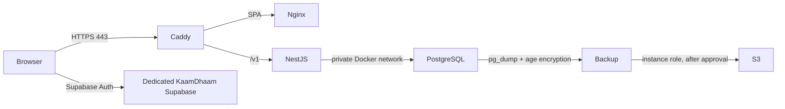

# Sprint 4 staging release plan (local preparation; no AWS deployment)

The current plan for the user's existing Sydney EC2 and GitHub Actions runner is [GitHub Actions deployment](github-actions-deployment.md). The Mumbai/t3.medium material below is the earlier unexecuted provisioning proposal.

## Proposed topology and approval boundary

`deploy/aws/staging.yaml` prepares one Amazon Linux 2023 x86_64 EC2 host, encrypted 40 GiB gp3 root volume, one Elastic IP, SSM access, a narrowly scoped S3 backup role, an encrypted private backup bucket, CPU alarm, SNS email, and monthly AWS Budget alerts. The template accepts an existing public VPC/subnet. It creates no NAT gateway, load balancer, RDS, or SSH ingress. Host failure takes the whole service down; recovery uses a new host and the latest verified encrypted backup. EBS survives instance termination in this template but remains in one Availability Zone. Review retained storage manually after stack deletion because the bucket and root volume can continue charging.

Recommend Mumbai `ap-south-1` for the first Indian audience, pending account availability, current regional quote, and credit eligibility. Hyderabad `ap-south-2` may be nearer some users but can require region opt-in. A US region may be cheaper but increases India latency. `t3.medium` (2 vCPU, 4 GiB) is the initial target; 2 GiB `t3.small` risks memory pressure with PostgreSQL, NestJS, Docker, proxy, and image builds. Graviton requires ARM image and Prisma native binary validation first. Build on a separate machine if host memory or disk is tight. Revisit size after measuring peak RSS, CPU credits, and p95 latency.

### Planning cost, before credits and tax

Assumptions: 730 hours/month, one continuously running t3.medium, 40 GiB gp3, one IPv4, 10 GiB S3 Standard backups, limited logs/snapshots and under 100 GiB monthly internet egress. This is a range, **not an AWS quote**. Confirm exact Mumbai prices in the [AWS Pricing Calculator](https://calculator.aws/) and the intended account before provisioning.

| Cost item | Monthly planning range (USD) | Basis |
| --- | ---: | --- |
| EC2 t3.medium | 32–42 | [AWS T3 size and example rates](https://aws.amazon.com/ec2/instance-types/t3/); Mumbai rate must be quoted |
| gp3 40 GiB | 3–5 | [EBS pricing](https://aws.amazon.com/ebs/pricing/) varies by Region |
| One public IPv4 | 3.65 | [AWS VPC price $0.005/hour](https://aws.amazon.com/vpc/pricing/) |
| S3 backup storage/requests | 0.5–3 | [S3 regional pricing](https://aws.amazon.com/s3/pricing/) |
| Snapshots, data egress, logs, alarms | 4–20+ | Highly usage dependent; verify in calculator |
| **Illustrative total** | **45–75+** | Excludes domain purchase, taxes and support plan |

Budget alerts are warnings, not a hard spending cap. The template's default `$80` monthly budget needs the user's chosen cap and email. Promotional credits might offset eligible line items, but balance, expiry, and service exclusions are unknown. An idle Elastic IP, retained EBS/S3, snapshots, DNS/domain, logs, and budget/monitoring services may continue billing after the instance stops.

## HTTPS and authentication

Use an owned hostname such as an approved subdomain, with its DNS A record pointing to the Elastic IP. A trustworthy HTTPS hostname is required; an EC2 IP by itself is insufficient. Caddy listens on 80 for ACME/redirect and 443 for HTTPS, persists certificates in `caddy_data`, and routes `/v1` directly to NestJS (one proxy hop) while Nginx serves the SPA. Only Caddy has public ports. `web` remains loopback-only at 8080; backend and DB expose no host ports. 443/UDP supports HTTP/3. Monitor certificate renewal and block sign-in until valid HTTPS. A temporary hostname is acceptable only if controlled and trusted with a valid certificate. Do not buy a domain or modify DNS without approval.

Staging Supabase Site URL: `https://<approved-staging-host>/`. Allow exact redirect URLs `https://<approved-staging-host>/onboarding`, `/login`, and `/reset-password`; local development retains `http://localhost:5173/onboarding`, `/login`, `/reset-password` (and `127.0.0.1` variants only if actually used). Never use wildcard production redirects. Supabase's own `/auth/v1/callback` handles any future OAuth provider callback; the app does not currently implement OAuth. Production needs a separate exact HTTPS host. Prefer a separate staging Auth project before wider public beta so test users and redirect policy cannot affect production, but create none without approval. The current project is dedicated to KaamDhaam development; no other project's keys are used.

`deploy/.env` and `deploy/backend.env` are ignored. Fill them from examples, set `STAGING_HOST`, exact HTTPS `CORS_ORIGINS`, the **dedicated** Supabase publishable URL/key and matching issuer/JWKS, random DB password and URL-encoded `DATABASE_URL`, and `TRUST_PROXY_HOPS=1`. Vite embeds `VITE_*` values at build time: public values only, and rebuild web on change. The backend checks production env at startup. No demo fallback is enabled in the staging image (`VITE_APP_MODE=live`). The browser stores Supabase session data; do not log tokens or callback fragments.

## Release and rollback (execute only after cloud approval)

1. Select AWS account and existing public VPC/subnet; verify matching Region, IAM Identity Center/temporary credentials, credits, regional quote, domain control, DNS TTL, alert email/cap, and backup public key. Never use AWS root keys. Review CloudFormation change set with `CAPABILITY_IAM` and stack policy; create the stack only after explicit approval.
2. Connect through SSM. Run `deploy/scripts/bootstrap-al2023.sh` with a pinned, SHA-256 verified official Compose plugin binary. Keep the repo and ignored env files under restricted ownership/mode. Confirm Docker, Compose, AWS CLI, clock and available disk. Adapt `deploy/docker-daemon.json.example` to the host's existing Docker configuration for local JSON log rotation before public traffic. Do not place long-lived AWS keys on the instance.
3. The current `release.sh` delegates to `release-ghcr.sh`; it pulls SHA-tagged images built by GitHub-hosted CI and does not build the application on EC2. See [GitHub Actions deployment](github-actions-deployment.md) for the current reviewed-SHA, backup, migration, and HTTPS gates.
4. After rollout, run the acceptance checklist below. Inspect `status.sh`, Docker restart counts, disk, CPU and CloudWatch. Record Git SHA, migration IDs, backup object, and certificate expiry.

Rollback: stop traffic or pause release, preserve logs and current volumes, check SQL compatibility, then redeploy a known-good Git revision and rebuild images. The script does not automatically reverse schema migrations. If data recovery is needed, restore an encrypted object to a **new** database/host and compare before any cutover. Never run `docker compose down -v`. A failed migration requires reviewing `_prisma_migrations` and the actual schema before retrying.

## Backup and monitoring policy

`backup.sh` streams `pg_dump -Fc` through age encryption, writes only ciphertext to disk, records SHA-256, and optionally uploads ciphertext and checksum to an approved S3 `backups/` prefix with the EC2 instance role. Its private age identity stays off the EC2 host. `restore-check.sh` validates decryption/archive integrity before creating a new `_restore_check` database, then restores without writing plaintext to disk. S3 uses Block Public Access, SSE-S3, versioning and 60-day lifecycle. Schedule daily backups, retain 14 daily plus weekly copies for eight weeks (the current 60-day lifecycle keeps all objects up to 60 days; weekly selection needs a scheduled retention process), and test restore monthly. RPO target 24 hours and RTO target 4 hours are **unmeasured design targets**. Alert for backup age over 36 hours, any upload failure, and restore drill failure. On a backup/upload failure, keep the last good object and investigate; never claim a local file is off-host protection.

Check `/v1/health` for process and `/v1/ready` for DB. Proposed alerts: 2 minutes unavailable, 5xx >2% over 5 minutes at useful traffic, p95 >2 seconds for 10 minutes, disk >80%, memory >80%, repeated restarts, CPU >80% for 10 minutes, certificate expiry <14 days. The template implements **CPU and budget alerts only**; remaining checks need host scheduling/CloudWatch agent or an approved uptime monitor. Limit Docker logs to 10 MiB × 3 files per container, restrict access, and use request IDs. Existing request logging omits tokens, headers, request bodies, private messages and query strings; inspect server exception messages for accidental secret disclosure after any new code. Verify disk/memory with `status.sh` and `docker stats` until an agent is configured. Set a documented log retention policy before public beta.

## Staging acceptance checklist (pending real staging)

1. Trusted HTTPS certificate and HTTP→HTTPS redirect.
2. Frontend and SPA routes load.
3. `/v1/health` and `/v1/ready` return 200.
4. Signup and confirmation redirect to onboarding.
5. Login, session restoration, token refresh and logout.
6. Password recovery callback, update, expired/used link message.
7. Client organization and job creation.
8. Freelancer job discovery and proposal.
9. Client shortlist and atomic hire; exactly one contract.
10. Both parties message and receive notifications.
11. Milestone submission, revision request, resubmission, approval and contract completion.
12. Third-party access is rejected.
13. Database persists through restart and an encrypted off-host backup restores to an isolated DB.
14. No development secret exposed in page, bundle, headers or logs.
15. Security headers, CORS, rate limiting, 5xx safety and request IDs.
16. Monitoring/alerts, backup age, retention and cost budget emails work.

`deploy/scripts/smoke.sh` automates HTTPS paths and one header. `scripts/live-smoke.mjs` accepts `KAAMDHAAM_FRONTEND_URL` for public/browser checks; use a configured Chrome/Edge path via `KAAMDHAAM_BROWSER`. The full authenticated two-user staging flow still requires dedicated staging accounts and an approved public environment. Do not run destructive browser flows against an unapproved site.
